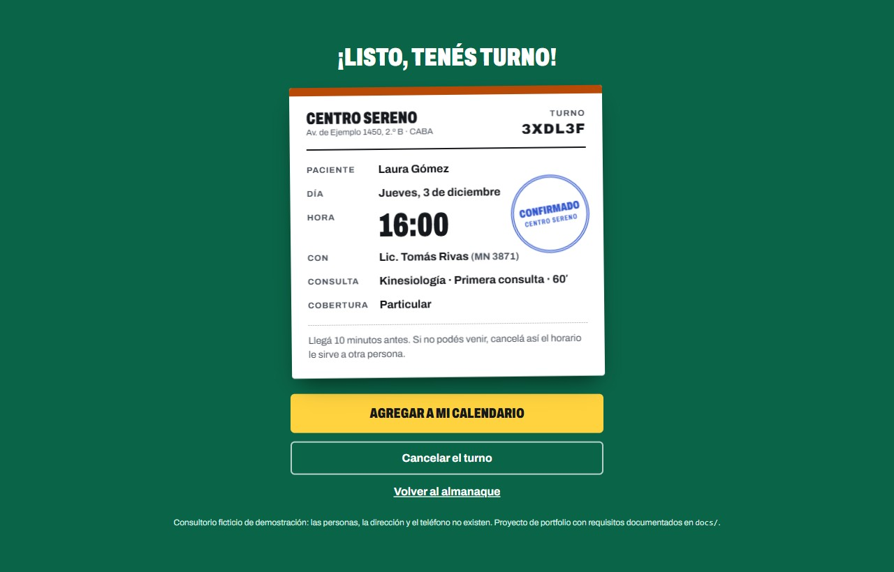
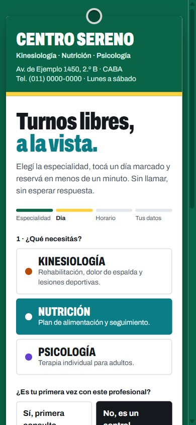
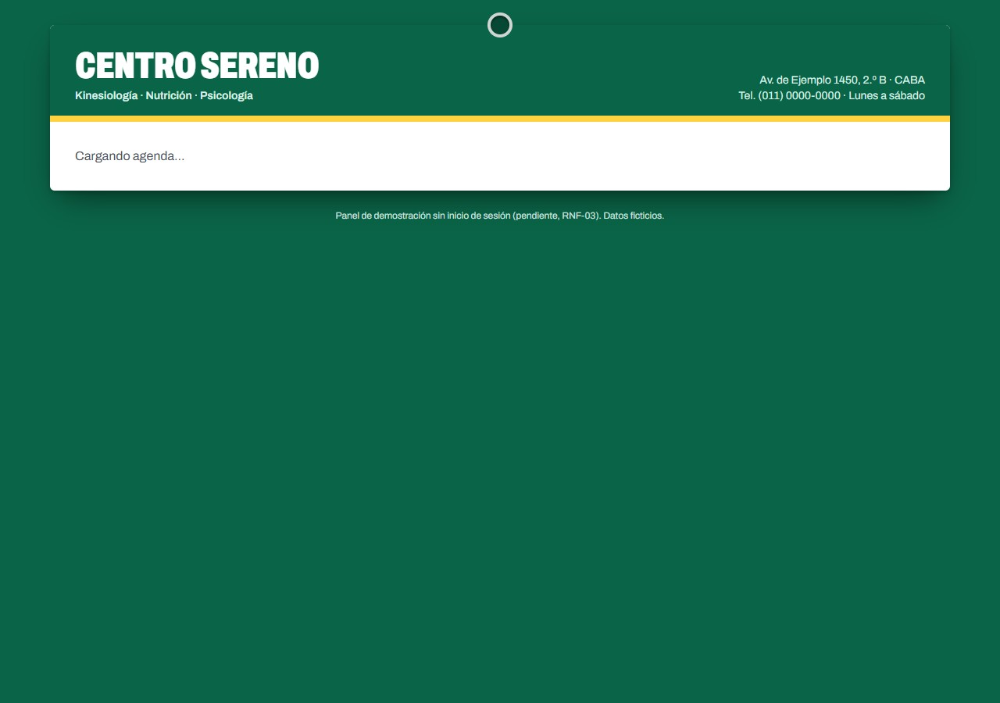

# turnos-consultorio

Reserva de turnos online para un consultorio de salud, con el **almanaque de farmacia** como interfaz: lo primero que ve el paciente son los días con lugar, y reserva en menos de un minuto. Incluye un panel para el consultorio con agenda, asistencia e indicadores.

Es un proyecto de portfolio que recorre **relevamiento → requisitos → diseño UX/UI → código → tests**, con un plan de validación con usuarios reales. El consultorio ("Centro Sereno") es **ficticio**.


## Por qué esta interfaz

| Decisión | Motivo |
|---|---|
| **La disponibilidad es la portada.** No hay botón "Reservar turno" que lleve a otra pantalla: el almanaque ya muestra qué días tienen lugar y cuántos. | El paciente viene a saber *cuándo* lo atienden. |
| **Un objeto que todos conocen.** Números grandes, domingos y feriados en rojo, "hoy" marcado con birome. | Menos carga cognitiva, sobre todo para personas mayores en el celular. |
| **Un solo recorrido, sin pantallas nuevas.** Especialidad → día → horario (en un talón troquelado) → 3 datos. Cada paso es un link: funciona sin JavaScript y el "atrás" del celular hace lo esperado. | Saber siempre dónde estás y qué elegiste. |
| **El comprobante es el cartoncito de turno,** con un sello que se estampa y la cancelación a un toque. | Cancelar tiene que ser tan fácil como reservar: así baja el ausentismo. |

Las hipótesis y cómo se van a validar con pacientes reales están en [docs/07-validacion-ux.md](docs/07-validacion-ux.md).

<p>
  
  
</p>

## Qué hace (v0.1)

| Funcionalidad | Requisito | Reglas |
|---|---|---|
| Almanaque con días con lugar por especialidad y tipo de consulta | RF-01 | RN-01 a RN-06 |
| Horarios del día agrupados por profesional; si no queda ninguno, ofrece el próximo día con lugar | RF-02 | RN-01 a RN-06 |
| Reserva con nombre, teléfono, email y cobertura | RF-03 | RN-04, RN-07 |
| Comprobante con código, link privado y archivo de calendario con alarma 24 h antes | RF-04 | — |
| Cancelación desde el comprobante, hasta 24 h antes | RF-05 | RN-05 |
| Panel: agenda del día por profesional | RF-06 | — |
| Panel: asistencia (vino / no vino) y cancelación con motivo | RF-07 | RN-08 |
| Panel: ocupación, ausentismo y ocupación por especialidad de la semana | RF-08 | — |

**Reglas que el sistema hace cumplir:** duración por servicio, turnos cada 30' dentro de la franja del profesional, de 2 h a 30 días de anticipación, **sin superposiciones aunque dos personas reserven a la vez** ([ADR-002](docs/decisiones/ADR-002-reservas-concurrentes.md)), domingos y feriados cerrados, y máximo 2 turnos pendientes por paciente.

**Pendiente (documentado):** recordatorios automáticos (RF-09), edición de horarios desde el panel (RF-10) e inicio de sesión del personal (RNF-03).



## Documentación

| Documento | Contenido |
|---|---|
| [Relevamiento](docs/01-relevamiento.md) | Partes interesadas, problemas, objetivos y alcance |
| [Procesos](docs/02-procesos.md) | BPMN AS-IS / TO-BE y ciclo de vida del turno |
| [SRS](docs/03-srs.md) | Reglas de negocio y requisitos funcionales y no funcionales |
| [Historias de usuario](docs/04-historias.md) | Criterios de aceptación en Gherkin |
| [Modelo de datos](docs/05-modelo-datos.md) | DER y decisiones de modelado |
| [Trazabilidad](docs/06-trazabilidad.md) | Objetivo → requisito → historia → test → código |
| [Validación UX](docs/07-validacion-ux.md) | Hipótesis, prueba de usabilidad y métricas planificadas |
| [Decisiones](docs/decisiones/) | ADRs |

## Stack

Next.js 16 (App Router, Server Actions) · TypeScript · Tailwind CSS 4 · PostgreSQL · Drizzle ORM · Zod · Vitest · GitHub Actions

```
src/
  domain/agenda.ts   reglas de agenda puras (RN-01 a RN-08)
  services/          disponibilidad, reserva con bloqueo, cancelación, agenda, indicadores
  app/               almanaque (/), comprobante (/turno/[codigo]), panel (/panel)
tests/               32 tests nombrados por ID de regla o requisito
docs/                relevamiento, SRS, historias, DER, trazabilidad, validación UX, ADRs
```

## Cómo correrlo

Node.js 24 o superior. No hace falta instalar PostgreSQL: en desarrollo se usa PGlite ([ADR-001](docs/decisiones/ADR-001-stack.md)).

```bash
npm install
npm run db:demo   # carga dos semanas de turnos ficticios (--reset para recargar)
npm run dev       # reserva: http://localhost:3000 · panel: http://localhost:3000/panel
npm test
```

## Datos

El consultorio, sus profesionales, la dirección, el teléfono y los pacientes son ficticios.
