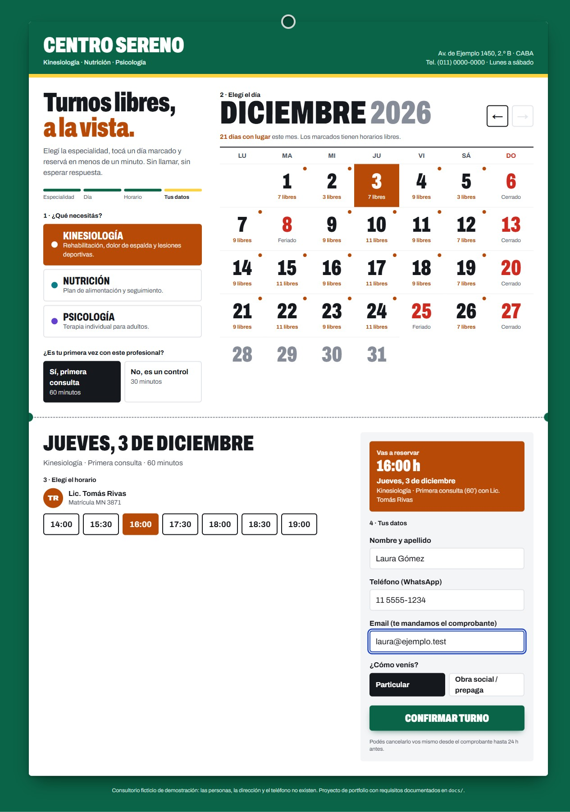

# Turnos para consultorio

Reserva de turnos online para un consultorio de salud. En lugar de empezar por un formulario, muestra un calendario inspirado en el almanaque de farmacia: se ve de entrada qué días hay lugar.



## Para el paciente

- Elige especialidad, día y horario, y completa sus datos.
- Recibe un comprobante con un enlace para verlo y un archivo para agregar el turno a su calendario.
- Puede cancelar desde ese comprobante hasta 24 horas antes.

<p>
  
  
</p>

## Para el consultorio

- Ve la agenda del día de cada profesional.
- Registra si el paciente asistió y puede cancelar turnos indicando el motivo.
- Consulta cuántos turnos se ocuparon en la semana y cuántas ausencias hubo.


El sistema no permite que dos personas se queden con el mismo horario, aunque confirmen al mismo tiempo.

## Estado

Es un proyecto de portfolio: el consultorio y todos sus datos son ficticios. Todavía faltan los recordatorios automáticos, la edición de horarios desde el panel y el inicio de sesión del personal. La [prueba con usuarios](docs/07-validacion-ux.md) está planificada, pero no realizada.

## Cómo probarlo

Necesitás Node.js 24 o superior. No hace falta instalar una base de datos.

```bash
npm install
npm run db:demo   # carga turnos de ejemplo (--reset para volver a cargarlos)
npm run dev       # pacientes: http://localhost:3000 · consultorio: http://localhost:3000/panel
npm test
```

## Cómo está hecho

Next.js, TypeScript, Tailwind CSS y PostgreSQL.

Antes de programar relevé el problema y definí los requerimientos. Todo está en [`docs/`](docs/): [relevamiento](docs/01-relevamiento.md), [procesos](docs/02-procesos.md), [requerimientos](docs/03-srs.md), [historias de usuario](docs/04-historias.md), [modelo de datos](docs/05-modelo-datos.md), [relación entre requerimientos y pruebas](docs/06-trazabilidad.md) y [decisiones técnicas](docs/decisiones/).
