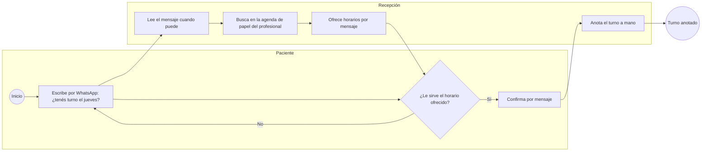
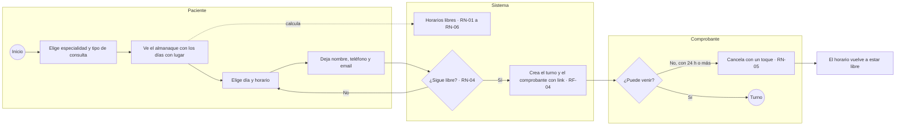
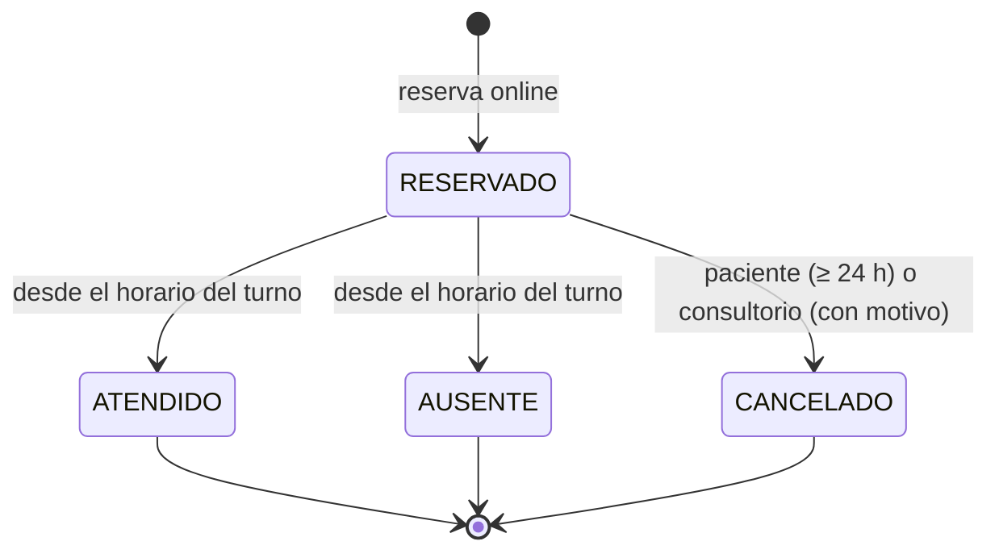

# 02 · Procesos (AS-IS / TO-BE)

BPMN simplificado en Mermaid: carriles por rol, eventos, tareas y compuertas.

## AS-IS: pedir un turno hoy

Puntos de dolor: espera entre mensajes (P-01, P-02), anotación manual (P-03) y ningún mecanismo para cancelar (P-04).

## TO-BE: reserva online

## Ciclo de vida del turno (RN-08)

Siguiente: [03 · SRS](03-srs.md).
