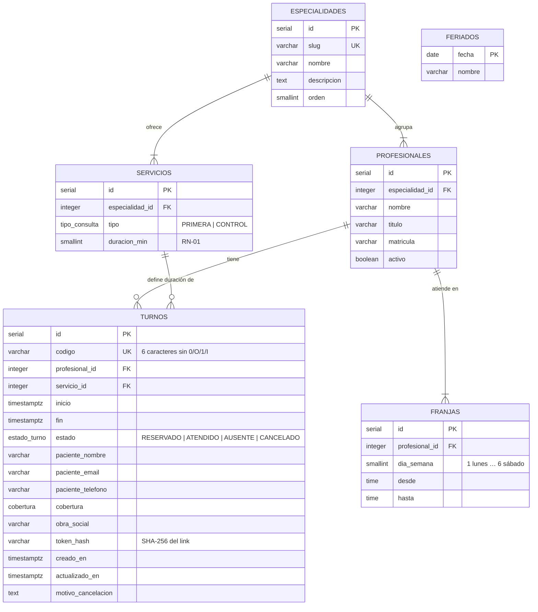

# 05 · Modelo de datos

Fuente de verdad: [`src/db/schema.ts`](../src/db/schema.ts). Migraciones en [`drizzle/`](../drizzle/).

## Decisiones de modelado

- **`fin` persistido** además de `inicio`: la superposición (RN-04) se calcula sin unir con servicios, y si mañana cambia la duración de un servicio, los turnos existentes conservan la suya.
- **Los horarios libres no se guardan:** se calculan con las franjas, los turnos y los feriados. No hay "slots" que sincronizar.
- **Token hasheado:** si se filtra la base, nadie puede cancelar turnos ajenos con los links.
- **Índice `(profesional_id, inicio)`** para calcular la disponibilidad de un rango de días con una sola consulta por especialidad.

Siguiente: [06 · Matriz de trazabilidad](06-trazabilidad.md).
